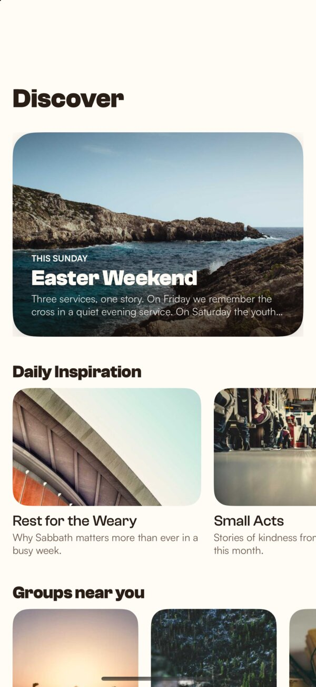
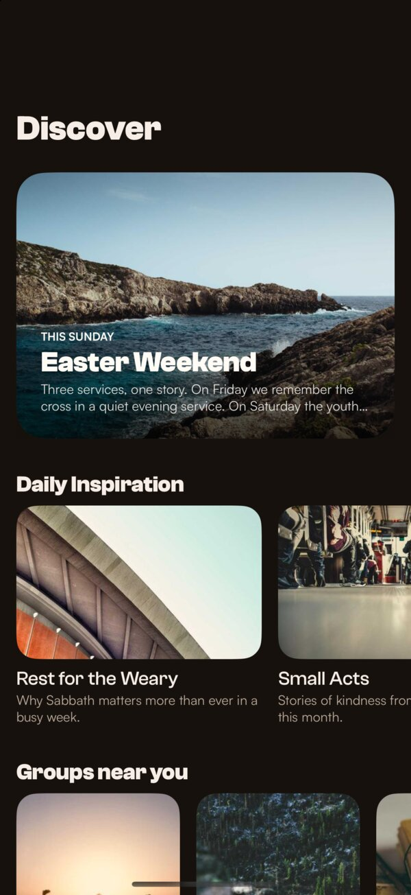

# DonkeyDiscover

A discover timeline for a church app, built with SwiftUI. You scroll down through inspiring content and church groups, and sideways through the carousels. Every card has an image, a title and a description. Tap a card to read the full text.

  
  

## Run

Open `DonkeyDiscover.xcodeproj` and run it on an iPhone or a simulator with iOS 17 or later. The images come from the internet, so you need a connection. The tests run with ⌘U and work offline.

- **On a device:** pick your own team under *Signing & Capabilities* and change the bundle identifier. The simulator needs neither.
- **Xcode version:** the app was built with Xcode 27. Xcode 25 and older can't build it, because the code uses Swift 6.2 and the iOS 26 SDK. Xcode 26 may not open the project file, because Xcode 27 saved it in a newer format. If that happens, please use Xcode 27.

## The feed

The feed mixes six card styles, so it feels like a curated timeline and not a long list of the same rows. Featured content and groups scroll sideways. Hero, banner, grid and list sections sit between them.

Once you have scrolled down, a button takes you back to the top. Light and dark mode follow the iPhone's setting.

The content is fake but always the same, so every launch and every test sees the same feed.

## Large dataset

The feed has 1,000 sections with about 11,500 items. To keep it smooth:

- Sections load in pages of 20. The next page loads before you reach the end.
- Only the cards on screen are built.
- Images load at the size the card needs, are kept in memory and on disk, and the next ones load ahead of time.

## Loading and errors

- While the feed loads, you see a shimmering outline of it.
- If loading fails, a short message explains why, with a button to try again.
- If an image can't load, the card shows a photo icon instead.

## Tests

23 unit tests cover:

- loading pages, stopping at the end and retrying after an error,
- the fake content,
- image loading and caching,
- that every color and font exists.

## Decisions

- **Own image loader** instead of `AsyncImage`, because `AsyncImage` doesn't cache images or load them ahead of time.
- **Detail screen**, because cards cut long text short. On iOS 18 and later the card zooms open, on iOS 17 it slides in.
- **No status bar**, because it flickered between light and dark over the images.